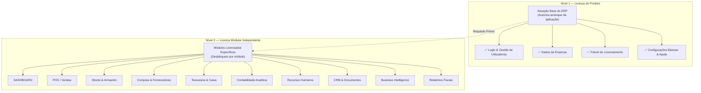

# Arquitetura de Licenciamento Modular em Dois Níveis e Proteção DRM

## 1. Princípio da Separação em Dois Níveis
Ao contrário de modelos convencionais onde a ativação do ERP libera automaticamente todas as funções, o VendaJá Angola implementa separação formal e física em dois níveis de autorização:



## 2. Especificação Técnica do Ficheiro de Licença
O ficheiro de licença corporativo (`*.key`) é codificado em Base64 contendo um payload JSON estruturado assinado digitalmente:
```json
{
  "licenseId": "LIC-2026-AO-00912",
  "companyId": "009341302LN046",
  "companyName": "Comércio Geral & Serviços de Luanda Lda",
  "nif": "5412998877",
  "hardwareId": "SHA256:d84f93a1...c018b",
  "plan": "ENTERPRISE",
  "productActivated": true,
  "licensedModules": [
    "DASHBOARD",
    "POS",
    "SALES",
    "STOCKS",
    "PURCHASES",
    "TREASURY",
    "ACCOUNTING",
    "HR",
    "CRM",
    "BI"
  ],
  "maxUsers": 25,
  "maxBranches": 5,
  "maxPosTerminals": 10,
  "issuedAt": "2026-01-01T00:00:00.000Z",
  "expiresAt": "2027-01-01T23:59:59.999Z",
  "gracePeriodDays": 15,
  "signature": "MEYCIQDx...82bA="
}
```

## 3. Mecanismos de Proteção e Resiliência
- **Assinatura RSA-2048**: A verificação ocorre localmente no cliente através da chave pública incorporada (`public.pem`). A chave privada (`private.pem`) reside exclusivamente no servidor central da software house.
- **Detecção de Anti-Clock Tampering**: O sistema mantém o carimbo temporal da última execução verificada. Caso o relógio do sistema operacional seja atrasado deliberadamente, o ERP entra em modo de bloqueio preventivo.
- **Preservação em Atualizações de Versão**: Durante a instalação de novos executáveis, o motor `update-migration-engine.ts` lê a licença existente da base local e garante que as novas versões do software herdam a licença válida sem exigir reativação manual.
