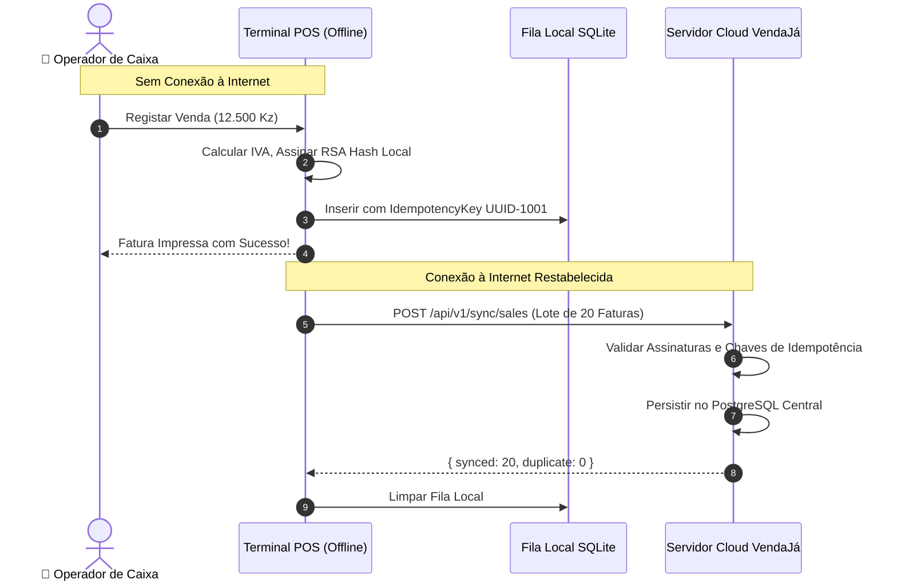

# Arquitetura Offline-First e Motor de Sincronização

## 1. Desafio de Conectividade em Angola
A infraestrutura de telecomunicações em Angola apresenta intermitências frequentes de sinal 4G/fibra e variações de latência. O ERP VendaJá Angola foi concebido para assegurar que lojas e operações de campo continuem 100% ativas mesmo após dias inteiros sem ligação à Internet.

## 2. Princípios do Motor de Sincronização
1. **Armazenamento Primário Local na Extremidade (Edge)**:
   - Toda venda, movimento de stock e check-in móvel é primeiramente validado e gravado localmente (SQLite no Electron / IndexedDB no browser).
   - O cliente recebe o comprovativo de venda ou registo imediatamente, sem esperar pela confirmação da nuvem.
2. **Garantia de Idempotência Absoluta**:
   - Cada transação gerada offline recebe um identificador único universal (UUID v4) imutável no momento da sua criação (`idempotencyKey`).
   - Se o motor de sincronização reenviar o mesmo pacote dez vezes por falha de timeout na rede, o servidor processa apenas a primeira ocorrência e descarta as 9 seguintes sem duplicar faturas ou pagamentos.
3. **Resolução de Conflitos Auditada**:
   - Para cadastros e configurações mestre: prevalece a versão do servidor corporativo (Single Source of Truth).
   - Para transações locais: agregação cronológica sem sobreposição de numerações de série fiscal (séries fiscais são dedicadas por terminal ou filial).

