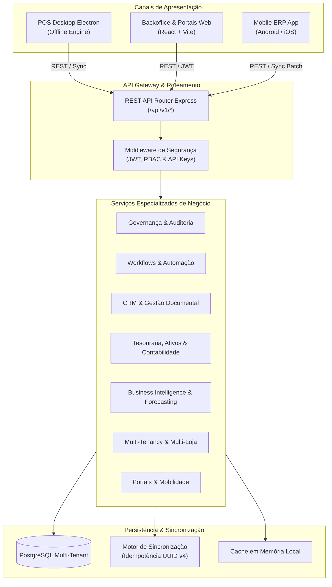

# Visão Geral da Arquitetura Enterprise — VendaJá Angola ERP

## 1. Topologia da Solução
O VendaJá Angola adota uma arquitetura em camadas orientada a serviços corporativos, permitindo distribuição multi-ambiente:
- **Camada de Apresentação (Frontend & Mobile)**:
  - Aplicação Desktop Electron (POS de alto desempenho, operação offline e controlo de hardware).
  - Aplicação Web / PWA React 18 + Vite (Backoffice corporativo e Portais Self-Service).
  - Aplicação Móvel Corporativa Android & iOS (Cockpit Executivo, Centro de Aprovações e CRM Georreferenciado).
- **Camada de Serviços & Domínio (Backend)**:
  - Node.js / Express com tipagem estrita TypeScript.
  - Conjunto de serviços modulares desacoplados: RBAC, Auditoria, Workflows, CRM, Finanças, BI, Multi-Tenant SaaS e Portais.
- **Camada de Dados & Persistência**:
  - PostgreSQL 15 Enterprise como base de dados relacional primária com Prisma ORM.
  - SQLite e IndexedDB nos nós de extremidade para operação offline autónoma e sincronização eventual.

## 2. Diagrama de Blocos da Solução

## 3. Padrões de Design e Engenharia Adotados
- **Clean Architecture / Hexagonal**: Desacoplamento entre lógica de negócio nuclear e adaptadores externos (impressão, ficheiros, bases de dados).
- **Idempotência Obrigatória**: Toda e qualquer transação de escrita financeira ou de sincronização offline carrega uma `idempotencyKey` única.
- **Segregação de Leitura e Escrita (CQRS)**: Separação de fluxos transacionais pesados de POS de rotinas analíticas e de relatórios de BI.
- **Defesa em Profundidade**: Múltiplas camadas de validação (Schema Zod / TypeScript no cliente, middleware de autenticação, RBAC no router e restrições de integridade no banco de dados).
